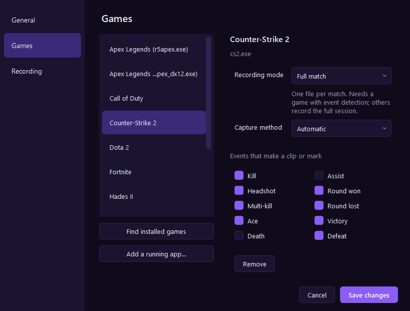
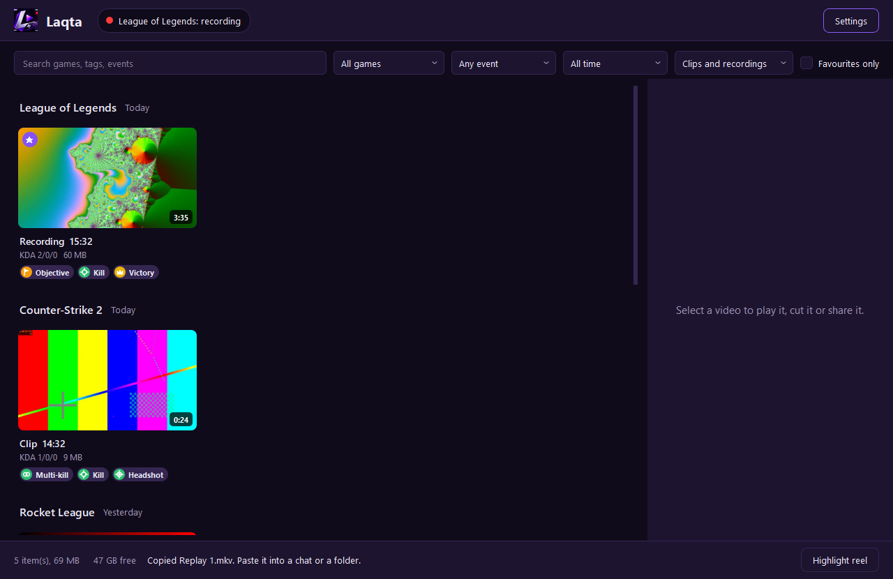

# Laqta · لقطة

A free, local-only game recorder for Windows. Laqta notices when a game starts and drives
[OBS Studio](https://obsproject.com) to record the whole session, each match, or short clips
around kills and other events.

- No ads, no account, no telemetry. Nothing leaves your PC.
- Nothing is injected into games and no game memory is read. Laqta uses OBS for capture, the
  games' own official local APIs for events, and screen analysis where no API exists.
- English and Arabic (right-to-left) interface.





## What you need

- Windows 10 or 11
- OBS Studio 30.2 or newer (developed against 33.0)
- [ffmpeg](https://ffmpeg.org) on your PATH, for trimming clips, thumbnails and MP4 export
  (`winget install Gyan.FFmpeg`)
- To run from source: Python 3.11 or newer

## Set up OBS (once)

1. Start OBS.
2. Open **Tools → WebSocket Server Settings**.
3. Tick **Enable WebSocket server** and click **OK**.

That is all. Laqta reads the port and password from OBS's own settings file, creates its own
profile and scene collection named `Laqta`, and never changes your existing ones. If OBS is
closed when a game starts, Laqta launches it minimised to the tray.

## Install and run

**Packaged build (what to give a friend):** download `Laqta-<version>-win64.zip` from the
[latest release](https://github.com/btk-q/Laqta/releases/latest), unzip it somewhere you can
write to (Documents or Desktop, not Program Files) and run `Laqta.exe`. Your clips window
opens; closing it leaves Laqta running next to the clock. Windows may show a "Windows
protected your PC" notice the first time, because the app is not code-signed: choose
**More info → Run anyway**.

**Updates:** at start Laqta asks GitHub whether a newer version exists. If there is one it
shows the patch notes and installs it with one click (the update is needed to keep using
Laqta; if it fails you can carry on with the old version). It waits until no game is being
recorded. The download is used only if its SHA-256 matches the one GitHub lists. This is one
anonymous request and sends nothing about you; turn it off in **Settings → Sharing and
updates**, after which Laqta never goes online by itself.

**From source:**

```powershell
py -3.12 -m venv .venv
.venv\Scripts\python -m pip install -e .[dev]
.venv\Scripts\python -m laqta
```

Check that Laqta can drive your OBS (records 5 seconds and saves a replay, then prints both paths):

```powershell
.venv\Scripts\python -m laqta obs-check
```

## Using it

Start a game from the list and Laqta records it. The tray icon gains a red dot while
recording. Right-click the tray icon for **Clip now**, **Clips**, **Settings** and **Quit**.

Recordings go to `Videos\Laqta\<Game>\<date>\`. Change the folder in **Settings → Recording**.

| Mode | What you get |
|---|---|
| Full session | One file from the moment the game opens until it closes, plus a `.json` next to it marking when each event and hotkey press happened. The default. |
| Hybrid | The same as Full session (which used to keep no marks). Kept so older settings still work. |
| Full match | One file per match. Needs a game with event detection; others record the session. |
| Events only | Nothing is kept except short clips around each event or hotkey press. |

Two hotkeys, both changeable in **Settings → General**:

- **Ctrl+Alt+F9, clip:** in Events only, saves a clip around this moment (with time before and
  after). In the recording modes it adds a mark.
- **Ctrl+Alt+F10, instant replay:** saves the last 30 seconds, ending the moment you press it.
  In the recording modes it adds a mark.

**Event symbols:** every kind of event has its own coloured symbol (green crosshair for a
kill, red cross for a death, amber flag for an objective, a crown for a win, a smiling face
for a laugh, and so on). They appear on the trim window's timeline with a legend underneath,
on each clip's tags, and on a strip in the side panel that shows where in the video each
event happened; click a symbol there to open the trim window on that moment.

**Clips window:** videos are grouped by game and day, newest first. Search by game, tag or event; filter by game, event, date and favourites;
play, tag, export as MP4, show in folder, or delete to the Recycle Bin.

**Watching:** Play (or a double-click) opens the video in Laqta's own player, with each event's
symbol on the seek bar: click a symbol to jump to just before that moment. Space plays and
pauses, the arrow keys jump five seconds, F goes full screen. Recordings keep the game and your
microphone on separate tracks; the sound menu lets you hear everything, the game alone or your
microphone alone. "Open in another player" is still there.

**Trim and export** shows the same player above a filmstrip with two handles and a symbol for
each event. Drag the handles (or use the arrow keys), click a symbol to jump to it, or
double-click it to select a clip around it; "Play selection" plays from one handle to the
other. Then save a trimmed copy, or export as vertical 9:16, as a Discord-sized file under
10 MB, or as 1080p 60 MP4, with a progress bar and Cancel. "Leave my microphone out" uses the
game-sound track.

**Highlight reel** joins the best moments of everything currently shown in the Clips window,
up to one minute, into one MP4 in `Exports`. Use the filters to choose the material, for
example one game today. Moments are ranked by event type (an ace outranks a kill; your own
hotkey presses rank near the top), nearby moments merge into one scene, and the reel plays
in the order things happened.

Favourites are never removed by automatic cleanup. Selecting a recording from a game with
event detection shows its length, kills, deaths, assists and result.

**Settings:** language, hotkey, mode for new games, per-game mode / capture method / event
toggles, quality and frame rate, clip timing, automatic cleanup by age or folder size, and
the interface colour. Settings are stored in `%APPDATA%\Laqta\config.toml`.

### Sharing

Everything here is off until you turn it on, in **Settings → Sharing**.

- **Copy** (Clips window) puts the video file on the clipboard, as Explorer's Copy does. Paste
  it into a chat or a folder. Nothing leaves the PC until you paste it somewhere.
- **Post to Discord** is the one feature that sends data off your PC. It appears only after
  you paste a Discord webhook address into Settings → Sharing. Pressing it on a clip asks for
  confirmation, then uploads that one clip (as MP4) to the channel the address belongs to.
  Nothing is posted automatically, and no address other than a Discord webhook is accepted.
  Files over 10 MB are refused with a pointer to the Discord export preset. The address is a
  secret kept in plain text in `config.toml`; the diagnostic file leaves it out.
- **Corner note:** shows Laqta's messages ("Clip saved") in a small window in the corner of
  the screen instead of a Windows notification, which Windows often hides during games. It
  never takes focus and clicks pass through it. It is an ordinary desktop window, so it
  cannot appear over a game in exclusive fullscreen.

### Keeping it running

- **Start with Windows:** tick "Start Laqta when I sign in to Windows" in **Settings → General**.
  It adds one entry for your user account only; untick it to remove the entry. If you switch
  it off in Task Manager instead, the box shows that.
- **Disk space:** Laqta does not start recording with less than 5 GB free on the recordings
  drive, and if the drive runs low mid-game it stops and saves the recording before the disk
  fills (a recording that fills the disk is lost). It starts again by itself when there is
  space. Change or turn off the limit in **Settings → Recording**. It never deletes files to
  make room; that is what the cleanup settings are for.
- **Health:** **Settings → Health** checks that OBS is installed and reachable, ffmpeg is
  found, the recordings folder is writable, there is disk space, the hotkeys are free and the
  video encoder is a graphics-card one, and says what to do about anything that is not right.
- **Diagnostic file:** the Health page (or `python -m laqta diagnose`) saves a zip with Laqta's
  log, the health results and your settings, for a bug report. Passwords and tokens are
  removed and your user folder is written as `%USERPROFILE%`; no recordings go in, but the
  names of games Laqta recorded do. Nothing is sent anywhere.

### Adding a game

**Settings → Add a game…** (at the bottom of the sidebar, under **My games**) opens a searchable list of the games installed on this PC
(from your Steam, Epic and GOG libraries) and the programs running right now. Select one or
more and add them; "Browse for a program…" covers anything else. The list is built from your
own PC; nothing is looked up online. Deadlock is in the built-in list (recording and hotkeys;
it has no event detection, because the game offers no official data feed).

Each game's page shows the recording mode as three choices and, for games with event
detection, one tile per event with its symbol: switch off the ones you do not want marked.

### Video quality

**Settings → Recording** offers four choices: **Light** (720p, 30 fps), **Balanced** (1080p,
60 fps), **High** (your screen's full size, 60 fps, near-lossless) and **Custom**, which
shows the size, frame rate, encoder and bitrate controls. A game can still have its own
values on its page.

### Sound

Recordings carry separate audio tracks: **1** is everything you hear, **2** is the game, **3** is
your microphone. Ordinary players use track 1.

- **Microphone** is off by default. Turn it on, pick the device and set its volume in
  **Settings → Audio**.
- **Game sound only** is a per-game option in **Settings → Games**. It keeps voice chat and
  music off track 2 and out of the mix.
- MP4 exports carry track 1 only.
- **Mark the moment when I shout** (Settings → Audio, off by default, needs the microphone
  on): when the microphone stays loud for a moment, Laqta saves a clip in Events only or adds
  a mark to the recording in the other modes, at most once every 10 seconds. It only compares the
  loudness figure OBS already measures; it does not listen to words, and nothing leaves the
  PC. Set how loud counts with the dB box. Unverified with a real voice: it was checked with
  a test tone.

- **Find my laughs and shouts** (Settings → Audio, off by default, needs the microphone on):
  when a game closes, Laqta listens to the microphone track of the recording with a sound
  recogniser (Google's YAMNet) that runs on this PC, and marks each laugh and each shout or
  scream. Ordinary talking is ignored, even loud and fast. Around each laugh it also saves the
  minutes leading up to it (5 by default) as a separate clip named "Funny …". It takes a few
  seconds per recording and nothing runs while you play. It needs a full recording, so it does
  not work in Events only. Checked on public-domain laugh and scream recordings and on
  synthetic speech; not yet on your own voice. `python -m laqta voice <video>` lists what it
  hears in any video.

### Picture

Laqta records the monitor the game is on, at that monitor's size, 60 fps. Change the output
size, frame rate, encoder and bitrate in **Settings → Recording**, or per game in
**Settings → Games**. If the encoder cannot keep up, Laqta tells you after the recording how
many frames were skipped; lowering the output size is the usual cure.

### Games

Ten games are built in. **Settings → Games → Find installed games** adds what it finds in
Steam, Epic and GOG; **Add a running app…** adds anything else. When an unknown app goes
fullscreen, Laqta asks once with a toast, and clicking the toast adds it.

### Event detection

| Game | How | State |
|---|---|---|
| League of Legends | Riot's Live Client Data API | Works. Checked against a real match's event list. |
| Counter-Strike 2 | Valve Game State Integration | Written and unit-tested with hand-built payloads. Not yet run in a real match. |
| Rocket League | The game's own Stats API | Written from the published format and unit-tested with hand-built messages. Not yet run in a real match. Goals, assists, saves, demolitions, win or loss, match start and end. |
| Valorant | Screen analysis | Framework and calibration tool only. It has no template images yet, so it detects nothing. Needs a real recording. |
| Everything else | Clip hotkey | Always available. |

Rocket League's Stats API is off by default. The first time Rocket League starts with Laqta
running, Laqta turns it on by changing one line (`PacketSendRate`) in your own
`Documents\My Games\Rocket League\TAGame\Config\TAStatsAPI.ini`, and asks you to restart the
game once. The game's install folder is not touched. The game does not say which player is
you: Laqta recognises the Steam accounts signed in on this PC, and for an Epic account you
type your in-game name in **Settings → Games → Rocket League**.

The first time CS2 starts with Laqta running, Laqta writes
`gamestate_integration_laqta.cfg` into CS2's `cfg` folder and asks you to restart CS2 once.

## If the recording is black

Some anti-cheat systems block OBS's Game Capture. Laqta checks the picture a few seconds in
and falls back to Window Capture, then to capturing the whole screen, and remembers what
worked for that game. You can also force a method per game in **Settings → Games**.

## Known limits

- **Vision plugins are not confirmed safe by any publisher.** They only read the screen, and
  no bans are known, but no publisher has stated that this is permitted.
- **Game-only audio is unverified in real games.** It works against ordinary apps; whether
  anti-cheat titles allow it is not yet known. If a recording comes out silent, turn it off
  for that game.
- **AMD and Intel encoders are unverified.** Laqta tries NVENC, AMF, Quick Sync, then x264,
  and uses the first that starts; only NVENC and x264 have been run.
- **Battle.net and EA libraries** are not scanned.
- **Post to Discord has never uploaded to a real channel.** The request is tested against a
  stand-in; it needs a webhook address to try for real.
- **Clutches are not detected in any game.** CS2 tells a playing client only about its own
  player, not how many teammates are alive, so a clutch cannot be told from an ordinary round win.
- **Start with Windows is unverified across a real sign-in.** The entry is written and read
  back correctly; nobody has signed out and in again to watch Laqta start.
- **A fast trim lands on keyframes** and can start up to two seconds early; tick "Cut on the
  exact frame" for a slower, exact copy.
- **OBS crash recovery:** if OBS dies mid-game, Laqta relaunches it and starts a new file. To
  do that unattended it clears OBS's "unclean shutdown" marker, which also skips OBS's
  safe-mode offer on that launch.

Per-game risks and the design are in [docs/ARCHITECTURE.md](docs/ARCHITECTURE.md).

## Adding a game plugin

A plugin turns one game's signals into events. It subclasses `GamePlugin`
([laqta/core/events.py](laqta/core/events.py)):

```python
class MyGamePlugin(GamePlugin):
    name = "mygame"
    event_types = ("kill", "death", "match_start", "match_end")

    def start(self, emit, game):   # begin detecting on your own thread; must not block
        ...
    def stop(self):                # stop and release everything; safe to call twice
        ...
```

1. Put the detection logic in a pure class that takes the game's data and returns
   `GameEvent`s, so it can be tested without the game. See `Tracker` in
   [lol_live.py](laqta/plugins/lol_live.py) (polling an API),
   [cs2_gsi.py](laqta/plugins/cs2_gsi.py) (receiving posts) and
   [valorant_vision.py](laqta/plugins/valorant_vision.py) (screen regions).
2. Register the class in [laqta/plugins/\_\_init\_\_.py](laqta/plugins/__init__.py).
3. Add `"plugin": "mygame"` to the game's entry in
   [games.json](laqta/game_detector/games.json).
4. Add English and Arabic names for any new event types in [i18n.py](laqta/i18n.py).
5. Write tests from captured real data, not from memory of the format.

Rules for every plugin: no injection, no memory reading, no handles into the game process.
Official local APIs first, then screen or audio analysis.

A step-by-step guide for AI coding assistants is in
[skills/add-game-plugin](skills/add-game-plugin/SKILL.md).

## Publishing a new version

1. Raise the number in `laqta/__init__.py`.
2. Add a `## <number>` section at the top of `CHANGELOG.md`: these are the patch notes shown
   in everyone's update window.
3. Commit, then run `powershell -File packaging\release.ps1`. It runs the tests, builds the
   zip and creates the GitHub release. Every copy of Laqta offers the update at its next start.

## Development

```powershell
.venv\Scripts\python -m pytest                 # tests; OBS and games are faked
powershell -File packaging\build.ps1           # builds dist\Laqta\Laqta.exe and a zip
.venv\Scripts\python -m laqta calibrate valorant "recording.mkv" --at 12:34   # see one moment as a vision plugin does; --cut saves a template
.venv\Scripts\python -m laqta vision-test valorant "recording.mkv"   # run a vision plugin over a video
.venv\Scripts\python -m laqta diagnose                                # health checks + diagnostic zip
```

Set `LAQTA_GSI_DUMP`, `LAQTA_LOL_DUMP` or `LAQTA_RL_DUMP` to a file path before starting Laqta
to save the raw data CS2, League or Rocket League sends, for building test fixtures.

## بالعربية

**لقطة** مسجّل ألعاب مجاني يعمل محليًا على ويندوز. يكتشف بدء اللعبة ويتحكم في OBS Studio
لتسجيل الجلسة كاملة، أو كل مباراة، أو لقطات قصيرة حول الأحداث. بلا إعلانات ولا حساب ولا
إرسال بيانات، ولا يحقن شيئًا في الألعاب ولا يقرأ ذاكرتها.

1. شغّل OBS وافتح **Tools ← WebSocket Server Settings** وفعّل **Enable WebSocket server**.
2. شغّل لقطة؛ ستظهر أيقونتها بجانب الساعة.
3. شغّل لعبتك. تُحفظ التسجيلات في `Videos\Laqta`.

لتغيير اللغة: انقر بالزر الأيمن على الأيقونة ← **Settings** ← **Language** ← العربية.
اختصار اللقطة الافتراضي هو **Ctrl+Alt+F9**.

من **الإعدادات ← عام** يمكن تشغيل لقطة مع بدء ويندوز. ولا يبدأ التسجيل إذا قلّت المساحة
الحرة عن 5 غيغابايت، ويتوقف ويحفظ الملف قبل امتلاء القرص. صفحة **الحالة** في الإعدادات
تفحص ما يحتاجه لقطة وتشرح علاج أي مشكلة، ومنها يُحفظ ملف تشخيص بلا كلمات مرور.

صفحة **المشاركة** متوقفة كلها افتراضيًا: نسخ اللقطة إلى الحافظة، ونافذة صغيرة في زاوية
الشاشة للملاحظات، والنشر في Discord. النشر هو الميزة الوحيدة التي ترسل بيانات خارج
حاسوبك، ولا يحدث إلا عندما تضغط الزر على لقطة واحدة وتؤكد.
